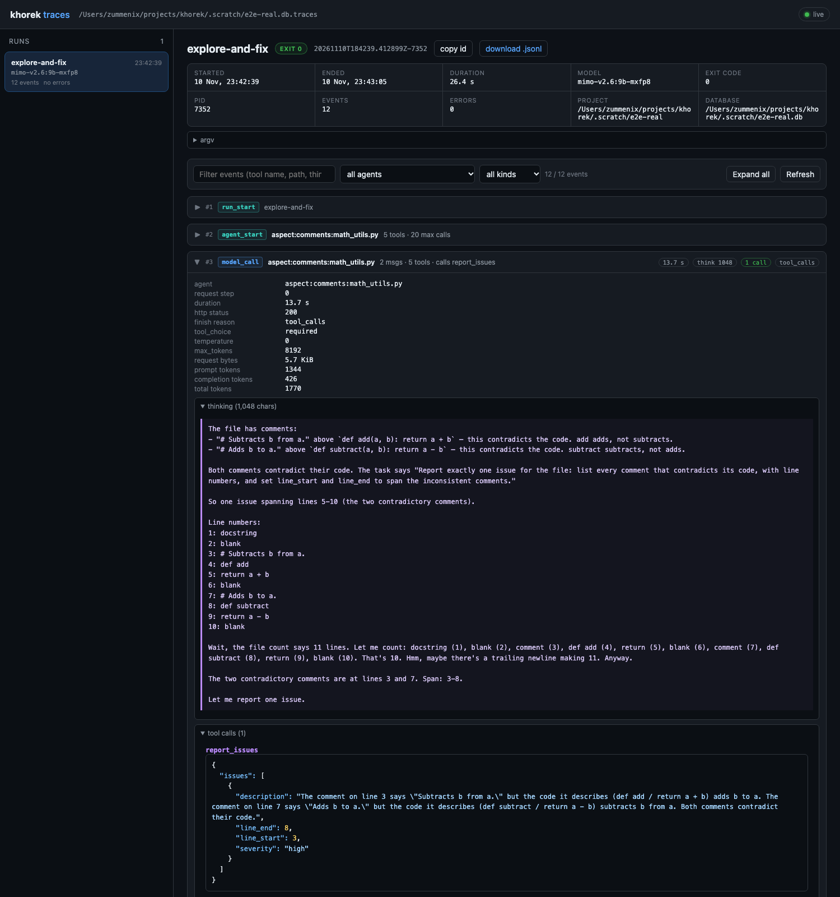

# Traces and the trace viewer

khorek can record every model call in full: the exact request payload (system
prompt, user prompt, message history, tool definitions, sampling settings) and
the model's raw response (content, `thinking`/`reasoning`, tool calls, usage,
finish reason, HTTP status, duration). Tool executions, repairs, and agent
errors are recorded too, so a failed or timed-out run still explains itself.

Tracing is opt-in.  It is diagnostic only: a trace I/O failure is reported once
and then ignored, so it can never fail a run.

## Enable it

```toml
[observe]
enabled = true      # default false
# directory = ".khorek/traces"   # optional; default: <db>.traces
keep_runs = 30      # keep the newest N runs; 0 = keep everything
```

Per invocation:

```bash
uv run khorek explore --limit 1 --trace
uv run khorek explore --limit 1 --no-trace          # wins over config + env
uv run khorek explore --limit 1 --trace-dir ./traces
```

Environment overrides: `KHOREK_TRACE=1|0` and `KHOREK_TRACE_DIR=/path`.  The
`--no-trace` flag always wins.  Traces default to `<db-path>.traces`, e.g.
`~/.khorek/<project-slug>.db.traces/`.

## Where the data lives

```
<db>.traces/
├── latest                       # run id of the newest trace
└── 20261110T184002.435528Z-6441/
    ├── meta.json                # command, model, argv, exit code, duration
    └── events.jsonl             # one JSON event per line, append-only
```

Each run directory is JSON Lines so the file is valid after a crash or a
`kill -9`.  Events are flushed after every write.  Every traced workflow prints
`trace: <run-dir>` as its final stdout line, so the newest trace is easy to
find.

### Event kinds

| kind | what it records |
| --- | --- |
| `run_start` / `run_end` | command, project, model, config limits, exit code |
| `agent_start` | agent label, system/user prompt, tool definitions and budgets |
| `model_call` | complete request payload, raw/structured response, `thinking`, tool calls, usage, finish reason, HTTP status, duration, size, error |
| `tool_call` | tool name, exact arguments, result or structured error, duration |
| `repair` | one malformed tool call and the exact error fed back to the model |
| `text_reply` | a text-only reply that triggered the "call a tool" reminder |
| `agent_end` | final text/structured data or error code, plus duration |

`model_call` events are self-contained: `request.messages` is everything the
model saw on that step, including prior tool results.  `request.tools` carries
each tool's name, description, and JSON schema.  `response` is the raw
OpenAI-compatible JSON body (or the body text when it could not be parsed).

## View it in a browser

```bash
uv run khorek traces                        # serves <db>.traces on 127.0.0.1:8765
uv run khorek traces --port 9000 --no-open
uv run khorek traces --trace-dir ./traces   # serve an explicit directory
```

The viewer is dependency-free (stdlib HTTP server + three static assets).  It
binds to localhost because traces contain source code and model output.



The UI shows:

- runs in the sidebar, with live updates while a run is in progress;
- per-run metadata (command, model, exit code, duration, DB, argv);
- a filterable event timeline (`j`/`k` to move, `Enter` to expand, `/` to
  search, `e` to expand all);
- for each model call: sampling settings, token usage, `thinking`, content,
  tool calls, the full message list, the tool schemas, the exact messages added
  since the previous call for that agent, and raw request/response JSON;
- warnings when `finish_reason=length`, which is the signature of a model that
  exhausted its token budget in a thinking loop;
- one-click copy of the request, response, or whole event and a `.jsonl`
  download for the run.

## Debugging recipe

1. Open the newest run and select a `model_call`.
2. Check `finish_reason`.  `length` means the model hit `max_tokens` before
   calling a tool; `thinking` will show what it was deliberating.  The harness
   aborts that agent immediately with a `budget` error instead of paying for a
   second identical call.
3. Check the request's `tool_choice` and `tools` names.  A model that calls
   `bash` is not seeing a shell: the repair event and the next request show the
   error returned to it and the list of available tools.
4. Read the `messages` panel.  This is literally the prompt, including the
   whole file (and, for the fixer, the reconstructed issue snippet).
5. Compare a failed `edit_file` call's `search` argument with the file content
   in the request.  A mismatch usually means the issue was hallucinated or the
   model copied text from the issue description instead of the file.
6. If a run timed out, the `model_call` event still exists with `error.code =
   timeout`, the full request, and the elapsed time.  Pair it with Ollama's
   server log or run the same request with a small `max_tokens` to see the
   truncated thinking.

## Output cap and per-agent thinking

The harness supports both `max_tokens` (hard output cap; Ollama maps
it to `num_predict`) and per-agent thinking control:

```toml
[llm]
think = true
max_tokens = 8192

[agents.aspect]
think = false      # structured whole-file review: no rumination
[agents.fixer]
think = false
```

`think` is inherited from `[llm]` unless set on an agent.  On Ollama's
OpenAI-compatible `/v1/chat/completions`, `think = false` is sent as
`reasoning_effort = "none"` (the documented thinking switch); `think = true`
leaves the model default alone unless `reasoning_effort` is set explicitly.

## External observability frameworks

khorek's built-in viewer is deliberately zero-dependency and tailored to this
harness.  If you want an off-the-shelf web UI instead, the best local-first fit
is **Arize Phoenix** (`uvx arize-phoenix serve`, SQLite storage, no Docker):
emit one OpenInference LLM span per `model_call` with `input.value` /
`output.value` set to the recorded request/response JSON.  **Langfuse
self-hosted** has the richest agent UI but needs Docker plus Postgres,
ClickHouse, Redis, and object storage.  **Pydantic Logfire** has the lowest
integration effort (its httpx instrumentation can capture raw bodies) but its
UI is SaaS; self-hosting is enterprise Kubernetes.  Generic OTel backends
(Jaeger, Tempo/Grafana) show timing and attributes but do not render prompts or
tool calls natively.

There is no OTel/httpx instrumentor that captures request/response bodies
automatically; only Logfire's own instrumentation does.  That is why khorek
records bodies itself rather than depending on a framework's HTTP hook.
